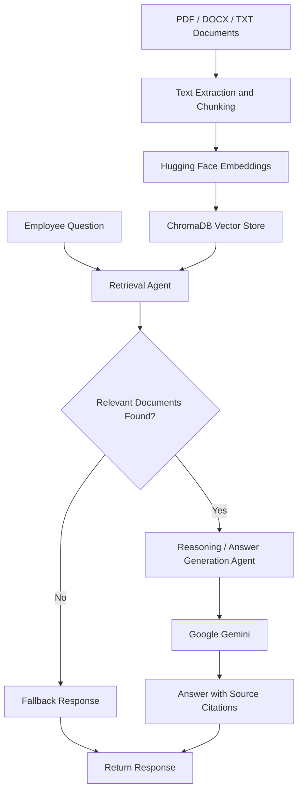

# Enterprise Knowledge Assistant

A multi-agent Retrieval-Augmented Generation (RAG) application that answers employee questions using indexed enterprise documents and provides source citations.

## Features

- **Document ingestion:** Supports PDF, DOCX, and TXT files.
- **Semantic retrieval:** Uses Hugging Face embeddings and Chroma vector storage.
- **Grounded responses:** Uses Google Gemini to generate answers from retrieved documents.
- **Source citations:** Displays source filenames and supporting document excerpts.
- **Relevance filtering:** Filters retrieved documents using a configurable distance threshold.
- **Unknown-question handling:** Returns a refusal when relevant indexed documents are not found.
- **API:** Exposes question-answering functionality through FastAPI.
- **User interface:** Provides an interactive Streamlit application.
- **Audit logging:** Records questions, answers, statuses, timestamps, and source references in JSON Lines format.

## Technology Stack

- Python
- LangChain and LangGraph
- Google Gemini
- Hugging Face embeddings
- Chroma vector database
- FastAPI
- Streamlit

## Architecture

The application uses a LangGraph-based RAG workflow to retrieve relevant
company information and generate answers grounded in indexed documents.



## Project Structure

```text
enterprise-knowledge-assistant/
├── app.py
├── api.py
├── audit.py
├── ingest.py
├── rag_graph.py
├── requirements.txt
├── .env
├── config/
│   ├── embedding_config.yaml
│   └── retrieval_config.yaml
├── documents/
│   ├── it_policy.txt
│   ├── reimbursement.txt
│   ├── sample_travel_policy.pdf
│   └── sample_equipment_policy.docx
├── logs/
├── vector_store/
└── README.md
```

## Prerequisites

- Python 3.12 recommended
- A Google Gemini API key
- Windows, macOS, or Linux
- Internet access for model/API requests

## Installation

Clone or download the project and open a terminal in its root directory.

Create and activate a virtual environment on Windows:

```powershell
python -m venv .venv
.\.venv\Scripts\Activate.ps1
```

Install dependencies:

```powershell
python -m pip install -r requirements.txt
```

## Environment Configuration

Create a `.env` file in the project root and configure the Gemini API key using the environment variable expected by `rag_graph.py`.

Example:

```text
GOOGLE_API_KEY=your_gemini_api_key
```

Replace the placeholder with your own key. Never commit `.env` or expose API keys in screenshots, source code, or logs.

## Add Documents and Build the Index

Place supported enterprise documents in the `documents/` directory.

Run:

```powershell
python ingest.py
```

The ingestion process loads supported files, splits their content into chunks, generates embeddings, and stores the indexed chunks in Chroma.

**Important:** The current ingestion script rebuilds the existing collection. Keep all documents you want indexed in the `documents/` directory before running it.

## Run the Application

### 1. Start the API

In the first terminal:

```powershell
uvicorn api:app --reload
```

API documentation:

http://127.0.0.1:8000/docs

Health check:

http://127.0.0.1:8000/health

### 2. Start the user interface

Open a second terminal, activate the same virtual environment, and run:

```powershell
streamlit run app.py
```

Open the local URL displayed by Streamlit, usually:

http://localhost:8501

Keep both the API and Streamlit processes running while using the application.

## Example Questions

**Reimbursement policy**

- Within how many days must expense claims be submitted?
- What documents are required for reimbursement?
- Who approves an expense claim?

**Travel policy**

- What is the daily meal reimbursement limit for domestic business travel?
- How many days before departure should employees book hotels?

**IT equipment**

- How soon must lost or stolen company equipment be reported?
- When must departing employees return their assigned equipment?

**Unsupported question**

- What is the company's Mars travel allowance?

The assistant should decline to answer questions when the indexed documents do not provide sufficiently relevant evidence.

## Audit Logging

Audit events are appended to:

```text
logs/audit.jsonl
```

Records include a UTC timestamp, question, status, answer, and source references. Errors are recorded with an error message.

For production use, add appropriate access controls, sensitive-data redaction, retention policies, and operational monitoring.

## Testing

Run the smoke tests:

```powershell
python smoke_test.py
```

Also verify:

- TXT ingestion and retrieval
- PDF ingestion and retrieval
- DOCX ingestion and retrieval
- Source citations and excerpts
- Rejection of unsupported questions
- API health and question endpoints
- Audit-log entries

## Limitations

- Retrieval quality depends on document content, chunking, embeddings, and the configured distance threshold.
- A valid citation label does not independently prove that every generated claim is supported by its cited source.
- LLM API availability and rate limits can affect response times and reliability.
- The project is a local demo implementation and needs additional security, evaluation, and deployment work before production use.

## Future Improvements

- Add automated retrieval and answer-quality evaluation.
- Improve citation-to-claim validation.
- Add retry handling for temporary LLM service failures.
- Add document upload and indexing status to the UI.
- Introduce authentication and authorization.
- Add monitoring and deployment configuration.

## Disclaimer

The included policy documents are fictional samples for testing and demonstration. They are not actual company policies.
